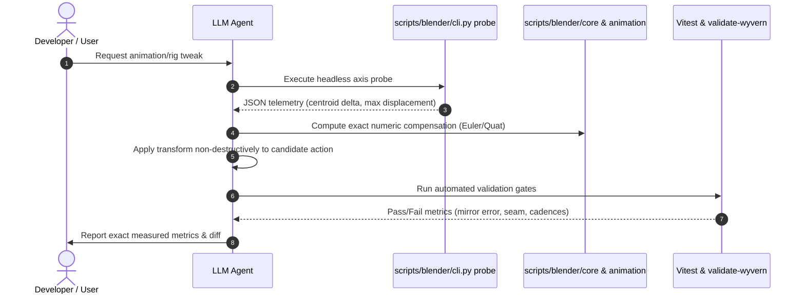

# Blender Automation & Telemetry Playbook (Wyvern3D V2)

This playbook establishes the development standard, architecture, and verification protocol for Blender authoring, rigging, and animation in **Wyvern3D V2**.

It is written specifically for human contributors and automated coding agents (Antigravity, Claude, Codex) to eliminate trial-and-error visual speculation and prevent regressions.

---

## 1. The Core Invariant: Numeric Truth Over Vision

Review and iteration in this codebase is **numeric, never visual**:

> A single still render flattens 3D depth, hides occluded bone rolls, and conceals defects behind dark textures. A 12-frame contact sheet misses single-frame hitches, interpolation spikes, and cadence drift.
> 
> **Never ask an LLM agent to grade an angle from a 2D image, and never accept an animation edit because a screenshot "looks fine".**

---

## 2. Directory & Asset Hygiene

### Runtime vs Authoring Separation
- **`public/models/`**: **Strictly runtime assets only** (`.glb`). No `.blend`, `.blend1`, or FBX source files may reside here. Next.js serves all files in `public/` over HTTP; loose authoring binaries bloat the client deployment.
- **`assets/blender/source/`**: Canonical authoring `.blend` files (`wyvern-rig-v1wing.blend`, `wyvern-rig.blend`).
- **`assets/blender/archive/`**: Archived reference and scratch scenes.
- **`.gitignore`**: Explicitly ignores all Blender auto-saves: `*.blend1`, `*.blend2`, `*.blend@`, `*.blend.*`.

---

## 3. Scene Hierarchy & Naming Conventions

### 2-Level Outliner Collections
Every authoring `.blend` must maintain a strict 2-level role collection schema:

```text
AUDIT | 00 Rig
└── WyvernRig                  # Armature object (Root bone has no parent)
AUDIT | 10 Geometry
└── WyvernMesh                 # Skinned Mesh (Armature modifier -> WyvernRig)
AUDIT | 30 Helpers & Sockets
├── SKT_RiderMount             # Empty parented to Spine2
└── SKT_MouthBreath            # Empty parented to Head (fire particle origin)
AUDIT | 80 Staging (Disabled on export)
├── Grid_GroundMetric_0.5m
└── Studio_KeyLight
AUDIT | 90 Cameras (Locked Orthographic review cameras)
├── Cam_Ortho_FrontXZ
├── Cam_Ortho_SideYZ
└── Cam_Perspective_Hero
```

### Bone Collections (Blender 4.0+)
Do not use legacy 32-bit layer flags. Assign bones to semantic Bone Collections:
- `DEF | Core`: `Root`, `RootMotion`, `Body`, `Spine1..3`, `Neck1..2`, `Head`, `Jaw`, `Tail1..10`
- `DEF | Wings`: `L_WingShoulder..Hand`, `L_WingD0P0..D4P2`, `L_WingPanel*`, and symmetric `R_`
- `DEF | Legs`: `L_LegRoot`, `L_Thigh`, `L_Calf`, `L_Foot`, `L_Toes`, and symmetric `R_`
- `MCH | Retarget`: Mechanism bones (unexported)
- `SKT | Sockets`: Gameplay attachment points

### Bone & Datablock Naming
1. **Bone Names are an Immutable ABI**:
   Export bone names (`L_WingD2P1`, `Spine2`, `Tail5`) map 1-to-1 to runtime animation tracks. Never rename an exported bone without updating `scripts/blender/wyvern_v2_rig_contract.json` and `manifest.ts`.
2. **Zero Duplicate Suffixes**:
   Ban Blender duplicate suffixes (`.001`, `.002`). The skinned mesh datablock must be named `WyvernMesh`, not `SKM_DaenerysDragon.001`.
3. **Action Naming**:
   - Canonical gameplay clips: exact string (`cruise`, `walk`, `idle`, `attack`).
   - Work-in-progress: `WIP__{clip}__{intent}__v{##}` (e.g. `WIP__idle__breath_harmonics__v02`).
   - All authored actions must set `action.use_fake_user = True`.

---

## 4. The Unified CLI: `scripts/blender/cli.py`

All headless operations are dispatched through `scripts/blender/cli.py`:

```bash
# 1. Audit exported GLB against rig contract (JSON chunk check)
python3 scripts/blender/cli.py audit-glb public/models/wyvern-gothic.glb

# 2. Audit open Blender scene (bones, parents, actions, skins)
blender -b assets/blender/source/wyvern.blend \
  -P scripts/blender/cli.py -- audit-scene

# 3. Organize open scene into role collections
blender -b assets/blender/source/wyvern.blend \
  -P scripts/blender/cli.py -- organize --out /tmp/organized.blend

# 4. Probe bone axis displacement against evaluated mesh
blender -b assets/blender/source/wyvern.blend \
  -P scripts/blender/cli.py -- probe --bones L_WingShoulder L_WingWrist --nudge 0.1

# 5. Sanitize materials and export game-ready GLB
blender -b assets/blender/source/wyvern.blend \
  -P scripts/blender/cli.py -- export --out public/models/wyvern-candidate.glb
```

---

## 5. Overcoming LLM Limitations: The Probe-First Loop

When an LLM coding assistant is asked to repair, retarget, or author a pose or animation:



### Probing Rule ("Régua antes do conserto")
1. **Never guess the rotation axis**: Probing `L_WingWrist` with 0.1 rad shows:
   - Axis **Z** yields primary sweep ($dy = +16.01$, max displacement $60.0$).
   - Axis **X** yields elevation ($dz = +15.00$, max displacement $53.5$).
   - Axis **Y** is axial torsion ($dy = -0.99$, max displacement $46.7$).
2. **Never guess the sign**: On Gothic V2:
   - Symmetrical wing elevation: **shared sign on X** (`mirror_wing_euler_degrees(rx, -ry, -rz)`).
   - Wing sweep: **negated sign on Z**.
   - Body pitch: **local Y**, not local X.
   - Neck sway: **local Y**, not local X.

### Continuous Verification
Every change must pass the Vitest continuous gate:
```bash
pnpm test src/render/assets/wyvernGothicValidation.test.ts
```
This single command validates:
1. **Three.js runtime evaluation**: wingtip mirror error $\le 0.0010$ m, seam closure $\le 0.0010$ rad, cadence sync $\Delta \le 8\%$, and initial keyframe at $t=0.00000$ s.
2. **glTF structural contract**: 92 joints, 18 clips, single skin, root node `WyvernRig`.
