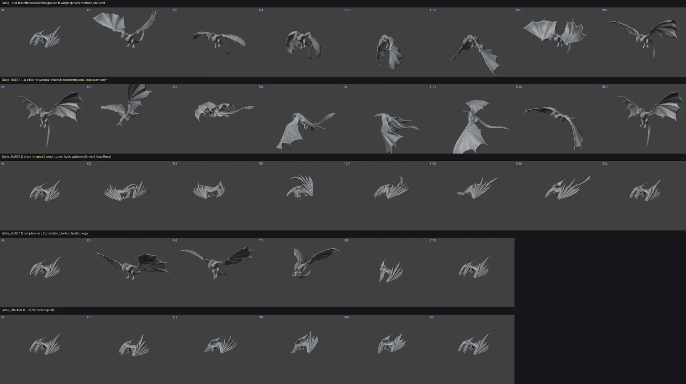

# Wyvern animation catalogue — `public/models/drogon.glb`

Every clip in the wyvern model, measured rather than guessed: frame counts and
durations read from the GLB itself, ground clearance and loopability sampled off
the posed rig in Blender. This is the reference for deciding which clip drives
which gameplay state, and it records the two facts that make the naive mapping
wrong (no root motion anywhere; the flight clip is a one-shot takeoff).

Source: Drogon — Game of Thrones Dragon by CoreMesh 3D, CC-BY-4.0 (see
`CREDITS.md`). Rebuild the runtime file with `python3 scripts/rebuild-drogon.py`.
Clip names are wired to gameplay states in `src/render/assets/manifest.ts`.

## The rig

| | |
|---|---|
| Bones | 292 joints, one root (`_rootJoint`) |
| Skins | 2 — body (`MI_DaenerysDragon`) and head (`MI_DaenerysDragon_Head`) |
| Meshes | 17 178 + 9 984 verts, 39 234 tris total |
| Clips | 52, all authored at **24 fps** |
| Textures | 2 × 1024² WebP colour maps, no normal or roughness maps |
| File | 15.6 MB, meshopt + WebP |

Two skeleton naming generations coexist. `Bip002-*` drives the body axis —
pelvis, spine ×4, neck ×3, head, tail ×7. `Bip001-*` drives the limbs. Useful
consequences:

- **There are no bones named "wing".** The wings *are* the arm chain:
  clavicle → upperarm → forearm → hand → 5 finger chains, 78 bones per side
  group, with the finger bones spreading the membrane. Anything that wants to
  pose or additively flap a wing works on `Bip001-*-Finger*`.
- **112 of the 292 bones are `Dummy*` / `Bone0NN` helpers.** They carry curves
  but no meaningful skin weight; ignore them when reading the rig.
- Sockets worth attaching effects to: `Bip002-Head_015` (fire breath origin and
  head-look target), `Bip002-Tail6_01` (tail tip),
  `Bip001-L-Foot_0178` / `Bip001-R-Foot_0182` (footstep dust).

## How the numbers were measured

> **This table is now generated evidence, not the source of truth.**
> `pnpm assets:analyze-clips` measures all 74 clips — these 52 plus the authored
> sidecar — into `validation/wyvern-animations/clip-signatures.json`, on one rig,
> with fourteen channels rather than two. The Ground-Y column below is its
> original 13-frame sampling; the signature file samples 48 and finds lower
> minima on 56 of the 65 clips measured at the time. See `docs/WYVERN_ANIMATION_BASELINE.md`.
>
> The catalogue is kept because it is the readable narrative of what each vendor
> clip *depicts*, which no channel measures.

Durations and channel counts come from parsing the GLB's animation sampler
accessors. The per-clip geometry comes from Blender, because it needs the skin
actually posed: import the source glTF, then for each action sample 13 frames
across its range, evaluate the deformed mesh, and record the world-space bounds.

```python
# per action, per sampled frame — the part that needs Blender
me = mesh_obj.evaluated_get(bpy.context.evaluated_depsgraph_get())
mesh = me.to_mesh()
co = np.empty(len(mesh.vertices) * 3); mesh.vertices.foreach_get('co', co)
world = co.reshape(-1, 3) @ M[:3, :3].T + M[:3, 3]   # M = matrix_world
ground_y = world[:, 2].min()                          # Blender is Z-up
me.to_mesh_clear()
```

Blender world units equal runtime GLB units for this rig, verified against the
idle clip's independently hand-measured `+1.55` clearance. Blender's frame
ranges and the GLB's sampler timings agree on all 52 clips at 24 fps, so the
frame column below is exact rather than a conversion.

### Regenerating the pose sheet

Measurements say where a clip sits; they do not say what it depicts. For that,
render it. Workbench rather than EEVEE or Cycles — the material is deliberately
near-black, so a lit render hides the pose, and Workbench's studio shading reads
silhouettes at roughly ten times the speed (71 frames in ~4 s here):

```python
scene.render.engine = 'BLENDER_WORKBENCH'
sh = scene.display.shading
sh.light, sh.color_type, sh.single_color = 'STUDIO', 'SINGLE', (0.62, 0.64, 0.68)
sh.show_shadows = sh.show_cavity = True
scene.view_settings.view_transform = 'Standard'   # technical sheet, not photographic
# then per clip: assign the action, frame_set() across its range, render each frame
```

Add a camera of your own rather than moving the scene's, hide the default Cube
and Icosphere from render, and restore all of it afterwards. `docs/wyvern-clip-poses.webp`
is the current sheet.

### Live Blender MCP Integration Protocol (`ws://localhost:9876`)

When Blender is running interactively on desktop with the MCP extension enabled, a non-blocking TCP server listens at `localhost:9876`. Automated agents can query, inspect, and manipulate active Blender scenes in real time over this socket.

- **Endpoint:** `localhost:9876` (`127.0.0.1:9876`)
- **Protocol:** Null-byte (`\0`) delimited JSON RPC over TCP socket.
- **Request Format:**
  ```json
  {
    "type": "execute",
    "code": "import bpy; result = {'scene': bpy.context.scene.name, 'bones': len(bpy.data.objects['Object_5'].data.bones)}",
    "strict_json": true
  }
  ```
- **Response Format:**
  ```json
  {
    "status": "ok",
    "result": { ... }
  }
  ```
  *(Returns `status: "error"` with `message`, `stdout`, `stderr` if script execution fails).*

Use this interface during sidecar authoring to sample live keyframe bounds, inspect joint transformations, or audit Blender scene state without closing the editor.

**Column meanings**

- **Ground Y min…max** — lowest point of the posed skin, at its lowest and its
  highest sampled frame, relative to the model origin. **This measures how far
  the silhouette reaches below the rig origin, not altitude.** A per-frame trace
  of `Battle_Up` and `Battle_Down02` settles it: the pelvis stays between 4.3 and
  7.1 across the whole takeoff with no upward trend, and sits at exactly 5.11 on
  every frame of the landing. The body never translates. What swings from `+1.75`
  to `-20.79` is the wings and tail extending — the tail tip alone travels from
  `+11.12` to `-10.27`. So a large negative number means *this pose is wide and
  low-reaching*, which matters because that geometry will pass through the ground
  if the creature is standing on it.
- **Stance** — derived from that reach: `planted` (never more than 0.9 below
  origin, so it sits correctly on terrain), `rearing` (dips below while lunging),
  `airborne` (reaches far below — safe only with altitude beneath it),
  `cinematic` (the silhouette leaves the ground plane entirely), `additive`
  (delta pose, see below).
- **Loops** — mean per-bone displacement between first and last frame. `yes`
  means under 0.25 units on a 44-unit creature, so the clip cycles seamlessly.
  The number in `no (…)` is how far the pose jumps at the wrap.

## Catalogue

All 52 clips. Prefix every name with `SKM_DaenerysDragon|DaenerysDragon_`, except
the idle, which is `SKM_DaenerysDragon|AA_DaenerysDragon_Battle_Stand`.

| Clip | Role | s | fr | Ground Y min…max | Stance | Loops |
|---|---|--:|--:|---|---|---|
| `Battle_Stand` | idle | 5.04 | 121 | +1.57 … +1.89 | planted | yes |
| `Neutural_Watch` | idle-long | 15.29 | 367 | +0.86 … +2.20 | planted | yes |
| `Neutural_Roar` | roar | 11.25 | 270 | -0.35 … +1.77 | planted | yes |
| `Neutural_BackKick` | kick | 9.38 | 225 | +0.18 … +2.19 | planted | yes |
| `Battle_Walk` | walk | 2.46 | 59 | -0.24 … +0.46 | planted | yes |
| `Battle_WalkL` | strafe | 2.50 | 60 | -0.81 … +0.43 | planted | yes |
| `Battle_WalkR` | strafe | 2.50 | 60 | +0.03 … +0.64 | planted | yes |
| `Battle_TurnL20` | turn | 4.08 | 98 | +0.82 … +1.79 | planted | yes |
| `Battle_TurnR20` | turn | 4.08 | 98 | +0.82 … +1.77 | planted | yes |
| `Battle_TurnL90` | turn | 4.08 | 98 | +0.41 … +2.03 | planted | yes |
| `Battle_TurnR90` | turn | 4.08 | 98 | +0.39 … +2.02 | planted | yes |
| `Battle_TurnL180` | turn | 4.12 | 99 | -0.09 … +1.75 | planted | yes |
| `Battle_TurnR180` | turn | 4.12 | 99 | -0.07 … +1.75 | planted | yes |
| `Battle_Up` | takeoff | 8.12 | 195 | -19.16 … +1.75 | airborne | no (6.8) |
| `Battle_Down` | landing | 5.29 | 127 | -22.89 … -1.96 | airborne | no (8.3) |
| `Battle_Down02` | landing | 4.67 | 112 | -20.28 … -0.17 | airborne | no (10.6) |
| `Battle_SkyMoveL` | air-bank | 8.33 | 200 | -23.39 … -4.92 | airborne | no (4.0) |
| `Battle_SkyMoveR` | air-bank | 8.33 | 200 | -23.40 … -5.37 | airborne | no (4.0) |
| `Battle_SkyMoveR01` | air-bank | 8.33 | 200 | -23.40 … -5.37 | airborne | no (11.0) |
| `Battle_Attack01` | attack | 8.08 | 194 | -1.91 … +1.75 | rearing | yes |
| `Battle_Attack02` | attack | 8.08 | 194 | -4.13 … +1.75 | rearing | yes |
| `Battle_Attack03` | attack | 6.25 | 150 | -1.76 … +1.75 | rearing | yes |
| `Battle_Attack04` | attack | 3.33 | 80 | -7.87 … +1.59 | airborne | yes |
| `Battle_Attack06` | attack | 3.33 | 80 | -0.45 … +1.75 | planted | yes |
| `Battle_Skill01` | skill | 7.58 | 182 | -3.95 … +2.63 | rearing | yes |
| `Battle_Skill02` | skill | 7.50 | 180 | -3.30 … +1.75 | rearing | yes |
| `Battle_Skill02_01` | skill | 7.50 | 180 | -4.60 … +1.75 | rearing | yes |
| `Battle_Skill03` | skill | 9.25 | 222 | +0.67 … +3.20 | planted | yes |
| `Battle_Skill03_01` | skill | 9.25 | 222 | +0.87 … +3.15 | planted | yes |
| `Battle_Skill05` | skill | 9.96 | 239 | -25.79 … +3.24 | airborne | no (6.8) |
| `Battle_Skill06` | skill | 8.62 | 207 | -25.80 … +2.01 | airborne | no (8.9) |
| `Battle_Skill07` | skill | 4.96 | 119 | -12.03 … +1.75 | airborne | yes |
| `Battle_Skill08` | skill | 3.21 | 77 | -32.45 … -7.83 | airborne | no (4.9) |
| `Battle_Skill10_L` | skill | 6.62 | 159 | -22.93 … -0.17 | airborne | yes |
| `Battle_Skill10_R` | skill | 6.62 | 159 | -23.23 … +0.24 | airborne | yes |
| `Battle_Skill11_L` | skill | 6.62 | 159 | -22.93 … -0.17 | airborne | yes |
| `Battle_Skill11_R` | skill | 6.62 | 159 | -23.25 … +0.11 | airborne | yes |
| `Damage_Staggering_Front_Body` | stagger | 3.88 | 93 | -0.34 … +1.96 | planted | yes |
| `Damage_Staggering_Left_Body` | stagger | 3.46 | 83 | +0.89 … +2.64 | planted | yes |
| `Damage_Staggering_Right_Body` | stagger | 3.46 | 83 | +0.77 … +2.43 | planted | yes |
| `Damage_GroggyStart` | groggy | 2.29 | 55 | -3.80 … +1.83 | rearing | no (5.4) |
| `Damage_GroggyLoop` | groggy | 2.50 | 60 | -2.04 … -1.97 | rearing | yes |
| `Damage_GroggyEnd` | groggy | 2.83 | 68 | -3.13 … +1.59 | rearing | no (5.4) |
| `Damage_GroggyAttack` | groggy | 9.54 | 229 | -14.22 … +1.75 | airborne | yes |
| `Damage_Add_BattleStand_Chest` | hit-delta | 1.08 | 26 | -33.73 … -33.59 | additive | yes |
| `Damage_Add_BattleStand_LeftFoot` | hit-delta | 0.46 | 11 | -15.05 … -15.05 | additive | yes |
| `Damage_Add_BattleStand_RightFoot` | hit-delta | 0.46 | 11 | -15.05 … -15.05 | additive | yes |
| `Damage_Add_Groggy` | hit-delta | 0.79 | 19 | -36.82 … -35.83 | additive | yes |
| `Death` | death | 14.92 | 358 | -2.15 … +1.83 | rearing | no (5.4) |
| `Death01` | death | 12.88 | 309 | -0.94 … +98.86 | cinematic | no (102.8) |
| `Spawn` | spawn | 6.33 | 152 | -3.70 … +2.31 | rearing | no (0.3) |
| `Spawn01` | spawn | 14.88 | 357 | -1.26 … +76.38 | cinematic | no (156.8) |

## What the clips actually depict

Rendered and read, not inferred from names. See `docs/wyvern-clip-poses.webp`.



- **`Battle_Up` is a takeoff — as a pose sequence, not as translation.** It opens
  folded and crouched, drives one big downstroke, and ends wings-spread and
  extended. The body does not actually rise: the pelvis oscillates between 4.3
  and 7.1 and returns. Like every clip here, altitude is the simulation's job.
  It cannot loop, because its last frame and first frame are a spread flight pose
  and a folded crouch.
- **`Battle_Down02`'s final pose is `Battle_Up`'s opening pose.** Takeoff and
  landing round-trip cleanly, so a `land → idle` chain will not pop.
- **`Battle_Skill11_L` really does loop** — frame 159 returns to frame 0 — but it
  reads as a swoop with a pitch-up and a roll, not level cruising. Acceptable for
  combat; a calm patrol over the sanctuary would look melodramatic.
- **`Battle_Skill07` is a complete leap, and the most useful surprise here.** Its
  `-12.03` clearance suggested a fragment of flight; it is actually grounded →
  wings out → brief air → land → back to rest, in 4.96 s, and it loops. That
  makes it a self-contained "hop" needing no transition plumbing at all.
- **`Battle_Skill03` is breath-shaped.** Wind-up, rear back, then a forward head
  thrust held from roughly f127 to f190 — a 2.6 s window to emit a flame effect
  into. Planted throughout, and it loops.
- **`Battle_Attack06` is a clean planted snap-bite**: rear, thrust the head
  forward and low, recover. 3.3 s, which reads as one blow.

`Skill10_L` and `Skill11_L` are near-identical but not duplicates — a pixel diff
of the same frames differs across ~3 800 pixels at f0, converging to near-zero by
f159. Treat them as two takes of one move, not one clip listed twice.

## What the measurements mean for gameplay code

**No clip has root motion.** `_rootJoint` and `Root_05` are static in all 52
clips. `Battle_Walk`'s pelvis travels 4.05 units of path but nets 0 — it is an
in-place cycle with a bob. The only exceptions are the two cinematics, where the
*pelvis* (not the root) is animated 160 units across the scene. So every
wyvern's world position must be driven by the simulation, which is what
`core/combat` already does. Never expect a clip to move a creature, and never
try to read distance travelled out of one.

**Roughly half the clips are one-shots, so a state machine cannot just loop
everything.** `Battle_Up` ends 6.8 units of pose away from where it started, and
its clearance sweeps from `+1.75` to `-19.16`: it is the ground-to-air
transition, not a cruise loop, and looping it snapped the pose back to the ground
crouch every 8.1 s. **There is no seamless level-flight loop in the vendor
file** — its only seamless airborne clips are the four `Skill10/11` variants,
which swoop. The Wyvern3D sidecar supplies the cruise and bank loops.
`ClipSpec` in the manifest now carries `loop` and `next` so `fly` plays the
takeoff and hands off to `airborne` when it finishes.

**Four clips are additive delta poses, not states.** The `Damage_Add_*` clips run
0.46–1.08 s and, played standalone, put the skin 15–37 units *below* the origin —
they encode an offset to be layered on top of a base pose, in an engine with
additive blending. three.js `AnimationMixer` has no additive blend space set up
here, so mapping one to a `ModelState` produces a creature buried in the ground.
Use `Damage_Staggering_*` for hit reactions instead: same purpose, authored as
complete planted poses.

**Every clip needs its own vertical offset, because each pose reaches a different
distance below the origin.** A single per-asset `yOffset: -1.55` is tuned for the
idle (skin min `+1.57`) and is wrong for everything else: `Battle_Walk` bottoms
out at `-0.24`, so it sinks 1.3 units, and `Neutural_Roar` at `-0.35` sinks 1.9.
`ClipSpec.yOffset` overrides per clip. The airborne clips need no offset at all
— they are only ever played with altitude underneath them — but playing one near
the ground would bury up to 23 units of wing.

**The two Death clips are not interchangeable.** `Death` (14.9 s) collapses in
place and is the right one — it is what the manifest maps. `Death01` climbs to
`+98.86`: the dragon flies away. `Spawn01` is the mirror image, entering from 160
units off and 76 up. Both are cinematics for a camera, not entity states.

**Blender truncates action names at 63 characters.** `Damage_Add_BattleStand_LeftFoot`
becomes `…_LeftFo` on import. The GLB keeps the full names and the manifest keys
off those, so never round-trip clip names through a Blender export and expect
gameplay to still resolve them.

## Currently wired

`manifest.ts` maps gameplay states across the vendor file and Wyvern3D sidecar:

| State | Clip | Play | yOffset |
|---|---|---|--:|
| `idle` | `Battle_Stand` / `Neutural_Watch` / `Neutural_Roar` | loop — one per `seed` | −1.55 / −0.86 / +0.35 |
| `walk` | `Battle_Walk` | loop — planted, 2.5 s | +0.24 |
| `fly` | `Battle_Up` | **once**, then chains to `airborne` | asset default |
| `airborne` / `cruise` | `Sanct_Cruise` | loop — three wingbeats, 6 s | airborne |
| `speed` / `glide` / `dive` | `Sanct_Speed` / `Sanct_Soar` / `Sanct_Dive` | loop; motion-selected | airborne |
| `bankLeft` / `bankRight` | `Sanct_BankL/R` | loop — phase-synchronized, 6 s | airborne |
| `hover` | `Sanct_Hover` | loop — 36° nose-up, four beats, 6 s | airborne |
| `attack` | `Battle_Attack06` | loop — planted, 3.3 s | asset default |
| `death` | `Death` | **once**, holds the collapsed pose | asset default |
| `hop` | `Battle_Skill07` | loop — self-contained leap | −1.75 |
| `breathe` | `Battle_Skill03` | loop — planted breath pose | −0.67 |
| `rest` | `Sanct_Rest` | loop — wakeful injured low rest | +2.21 |
| `land` | `Battle_Down02` | **once**, then chains to `idle` | airborne |

`airborne` is internal: a real takeoff asks for `fly` and chains into it.
Battle wyverns already spawn at cruise altitude, so `BattleScene` starts on
`glide` and selects left/right bank loops from turn rate.

Forty vendor clips remain unused. What is left there is not more art — it is
states for gameplay to ask for, and the exit transitions that the enter
transitions imply.

## Sanctuary animation sidecar

`public/models/drogon-sanctuary.glb` adds twenty-two Wyvern3D-authored actions without
round-tripping the vendor file. It is meshless and skinless: only armature nodes
and animation channels ship. `GameModel` concatenates its clips with the base
clips before applying the manifest filter.

| Action | Role | Frames | Loops | yOffset |
|---|---|---:|---|---:|
| `Sanct_Sleep` | closed-jaw curled sleep; 0.30-unit breath | 120 | yes | +2.14 |
| `Sanct_Rest` | wakeful injured low pant; 49.8° jaw | 144 | yes | +2.21 |
| `Sanct_Sit` | rest → upright seated transition | 48 | no | −0.58 |
| `Sanct_SitLoop` | seated breathing | 96 | yes | −0.41 |
| `Sanct_Rise` | seated → rest transition | 48 | no | −0.58 |
| `Sanct_Eat` | planted bite, tear, chew, and swallow loop | 192 | yes | +0.86 |
| `Sanct_Drink` | muzzle dip and lap | 144 | yes | +0.63 |
| `Sanct_Groom` | turn back and preen | 192 | yes | −0.89 |
| `Sanct_HuntGrip` | reach, bite, and secure prey | 72 | no | +0.49 |
| `Sanct_HuntCarry` | powered prey-carry flight; braced neck and jaw | 144 | yes | airborne |
| `Sanct_HuntFinish` | final chew, swallow, scan, and idle recovery | 120 | no | −0.88 |
| `Sanct_PerchGrip` | subtle talon grip | 72 | yes | −1.46 |
| `Sanct_Cruise` | level cruise; 107.7° stroke, three symmetric wingbeats | 144 | yes | airborne |
| `Sanct_Scout` | slow loitering search; 0.333 Hz, two symmetric wingbeats | 144 | yes | airborne |
| `Sanct_BankL` | left bank; left wing low, inside stroke 82.9° vs outside 112.1° | 144 | yes | airborne |
| `Sanct_BankR` | right bank; exact mirror of left | 144 | yes | airborne |
| `Sanct_Hover` | 32.1° nose-up hover, four faster wingbeats | 144 | yes | airborne |
| `Sanct_Speed` | fast cruise; 0.8 Hz, nose-down on every frame | 120 | yes | airborne |
| `Sanct_Soar` | unpowered glide; wings held extended, no cycle | 144 | yes | airborne |
| `Sanct_Dive` | stoop; 27.8° nose-down, wings held folded, no cycle | 144 | yes | airborne |
| `Sanct_Nuzzle` | lowered-head nuzzle and return | 96 | no | −1.19 |
| `Sanct_Calm` | folded-wing settle and slow exhale | 120 | no | −0.58 |

All twenty-two are authored at 24 fps, target 292 existing base nodes, and contain
876 three.js tracks each. Every looping clip returns exactly to its opening
location, quaternion rotation, and scale. Rebuild with
`pnpm assets:drogon-sidecar`; validate runtime binding with
`pnpm assets:validate-sidecar`; measure with `pnpm assets:analyze-clips`, which
is what `pnpm test`'s contract gate reads.

Every `yOffset` above is the negated `ground_clearance.min` in
`clip-signatures.json`. Four changed when the measurement moved from 13 samples
per clip to 48 — the nuzzle by 0.54 units, which it had been floating by.

### Current sanctuary flight mapping

- Takeoff: vendor `Battle_Up`, once, while the sanctuary director raises the
  wyvern to patrol altitude.
- Mid-flight patrol and transit: `Sanct_Cruise`, a seamless six-second loop with
  three symmetric wingbeats sweeping 107.7°, on a 2.1° head-to-tail cruise line.
  Each beat is nine measured landmarks of `Battle_Down02` f40–f66, which is what
  keeps its stroke plane (52.1° of azimuth) and wrist fold (6.37 of extension
  travel) — both lost when the same beat was built from four.
  That separates forward flight from the upright silhouettes used by hovering,
  takeoff, and landing.
- Circle and patrol search: `Sanct_Scout`, the same measured wing mechanics
  slowed to two beats in six seconds (0.333 Hz) on a +8.1° body line. It stays
  outside the phase group because its two beats cannot share normalized phase
  with cruise's three; a visible turn still takes the bank loop instead.
- Left/right course changes: wrapped yaw rate drives both a smoothed whole-model
  roll and `Sanct_BankL/R`. A bank carries two authored layers, both from one
  constant because the geometry couples them: a 24.3° left/right wingtip
  elevation difference (inside wing low) and a 29.1° difference in how far each
  wing *travels* — the inside wing sweeps 82.9° against the outside wing's
  112.1°. Until this was probed on the rig the banks supplied neither: the
  recipe drove the two wing chains with opposite signs, which with the mirror
  applied moves the elevation bias by 0.0°. The tail counterbalances 1.2 units
  to the outside of the turn. A 0.14-radian enter threshold and 0.07-radian exit
  threshold prevent state chatter.
- Near-zero horizontal speed: `Sanct_Hover`, 32.1° nose-up with four wingbeats in
  the same six seconds. `flightAnimationState` enters it below 2 units/s and
  leaves above 4, and only callers that pass `horizontalSpeed` opt in.
- `airborne`, `cruise`, and the bank loops share the `flight` phase group.
  Crossfades preserve normalized action time, so banking never restarts the
  current wingbeat. Climbs and descents pitch the full model from vertical
  velocity. **Hover is deliberately outside that group**: phase preservation
  carries normalized time, which only keeps two loops in step when they share a
  beat count as well as a duration. Scout, speed, glide, dive, and hover stay
  outside it because each differs in cadence or propulsion. `animationContracts.test.ts`
  asserts the rule.
- Landing: vendor `Battle_Down02`, once, while the director lowers the wyvern
  onto its selected perch.

The vendor `Battle_SkyMoveL` and `Battle_SkyMoveR` clips remain deliberately
unmapped: both include substantial non-looping displacement, so using either as
a repeated turn would introduce a visible snap. The authored sidecar banks
provide the needed skeletal deformation without their non-looping displacement.

Battle wyverns spawn at cruise altitude and therefore begin directly on
`Sanct_Cruise`; only a real ground-to-air transition requests `Battle_Up`.

## Development and review contract

Use `docs/FLIGHT_ANIMATION_DEVELOPMENT.md` for all new flight clips, state
selection, procedural attitude, and flight-camera changes. This catalogue says
what the assets contain; the development guide says how motion is specified,
authored, validated, and promoted.

In particular, do not approve a flight action from loop integrity and an
auto-framed contact sheet alone. Primary posture needs a written locomotion-mode
contract, fixed-origin side/front/top review, transition review, and live
battle/sanctuary camera checks at runtime scale.

## Development path

Staged so each step is shippable on its own and none of them touch `core/**`.

**~~1. One-shot and transition support.~~ Done.** `ClipSpec` carries `loop` and
`next`; `GameModel` sets `LoopOnce` + `clampWhenFinished` and advances state from
the mixer's `finished` event. Verified in a live battle: the takeoff hands off to
the swoop cycle instead of snapping back to the ground crouch, and `death` now
holds its final pose rather than standing the corpse back up.

**2. Exit transitions (landing) — blocked on gameplay, not on the model layer.**
Airborne → grounded should play `Battle_Down02` before `idle`, and the pose sheet
shows it lands exactly on `Battle_Up`'s opening frame, so the transition would be
seamless. But nothing can trigger it: `Actor.flying` is assigned once in
`createEncounter` (`true` for wyverns, `false` for squads) and never mutated, so
a wyvern never lands and `BattleScene` never emits `fly → idle` for one. Build
the landing when combat gains a reason to land — a stamina floor, a retreat, a
grounded-by-damage state — not before, or it is machinery with no caller.

**~~3. Per-clip vertical offset.~~ Done.** `ClipSpec.yOffset` overrides the
asset's, and `GameModel` uses it for the state that is actually playing. Measured
values are in the manifest.

**~~4. Idle variation.~~ Done.** A state may now map to an array of `ClipSpec`,
picked by the entity's `seed`; the sanctuary passes the perch index. All three
idles loop, are planted, and carry their own offset. Verified by driving the seed
through 0/1/2 and confirming three distinct poses on the same wyvern.

**5. Station behaviour.** Wire `assignment.kind` to a state, per the plan in
`docs/ASSET_INDEX.md`. Every clip below is confirmed by the pose sheet: flight
ring → `Battle_Skill07`, a self-contained leap that takes off, flies briefly and
lands, needing no transition plumbing at all; burn range → `Battle_Skill03`,
emitting flame during its held f127–f190 thrust; hunting pen → `Battle_Attack06`;
endurance run → `Battle_Walk`; scale forge → `Battle_Stand`; injured →
`Damage_GroggyLoop`.

**6. Turn-in-place.** Six turn clips exist at 20°/90°/180° each way, all planted
and looping. Once wyverns physically move to stations they will need them, and
picking by yaw error is straightforward. Do this after movement exists, not
before.

**7. Effect sockets.** Attach fire breath to the dragon skull
`Bip002-Head_015`, with its outgoing direction measured from the final neck
link; `B_Face_Jaw_00_0160` belongs to the rider skeleton and is not a dragon
socket. Footstep dust belongs on the two foot bones, and wing gusts on the finger
chains. These need a bone lookup on the cloned skeleton; they do not need new clips.

Deliberately not on this path: the remaining `Battle_Skill*` variants, `Death01`,
`Spawn01`, and the four `Damage_Add_*` deltas. They need either a cinematic camera
system or additive blending, neither of which exists.

## Pipeline contract

Decided once, because two reasonable workflows conflict here.

- **Blender must not round-trip the base asset.** It may measure, preview and
  render the vendor file, and it may author short-name actions in the separate
  armature-only sidecar. Two vendor clip names exceed Blender's 63-character
  action-name limit, so re-exporting `drogon.glb` from Blender still breaks state
  lookup silently.
- **The runtime owns motion logic.** Sequencing, looping, blending and transitions
  live in `GameModel` and the manifest, not in NLA strips or baked keyframes. That
  keeps one 15.6 MB file serving all five species and keeps art direction a
  one-line edit.
- **`core/**` never learns about any of it.** Clip choice, timing and offsets are
  cosmetic. Collision radii, ranges and speeds stay in `core/data`.
- **Rebuild the base only through `scripts/rebuild-drogon.py`.** It asserts 52
  clips, two skins and a `baseColorTexture` on every material. Build additions
  through `scripts/build-sidecar.py`, which rejects geometry and any animation
  target not present in the base node set.
